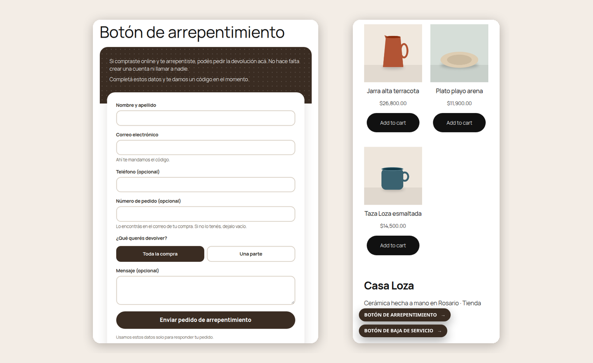

# Botón Claro – Botón de arrepentimiento y baja de servicio para WordPress y WooCommerce

**Que ningún pedido de devolución o de baja se te pierda, y que tus clientes compren tranquilos.**

Botón Claro suma a tu tienda el "BOTÓN DE ARREPENTIMIENTO" y el "BOTÓN DE BAJA DE SERVICIO" que pide la Disposición 954/2025. Tu cliente hace un clic, completa un formulario corto y recibe un código de pedido en el momento, en pantalla y por correo. A vos te llega un aviso y ves cuánto tiempo te queda para responder.

## Lo que gana tu tienda

- **Ningún pedido perdido.** Cada pedido entra con su código a una lista, con aviso por correo. Si un correo falla, se reintenta y te avisamos.
- **Menos reclamos.** El cliente tiene su código al instante y sabe que su pedido llegó, sin llamar ni escribir.
- **Clientes que compran con confianza.** Los botones se ven en todas las páginas, con tus datos de atención al cliente al lado.
- **Listo en 3 minutos.** Una configuración guiada arma los botones, las páginas del formulario y el aviso. Funciona con cualquier tema, con o sin WooCommerce.

La versión gratis está completa: sin límites de pedidos y sin funciones bloqueadas. Tus datos y los de tus clientes quedan en tu sitio: no se conecta a ningún servicio externo.

## Botón Claro Pro: cada pedido resuelto en un clic

Mirá al instante si un pedido está dentro de los 10 días, feriados incluidos. Aceptá, devolvé el dinero y reponé el stock en un clic, respondé con correos listos para cada caso, cancelá suscripciones con su constancia, recibí alertas antes de que venza un plazo y exportá todo a CSV.

**[Comprar Botón Claro Pro](https://checkout.freemius.com/plugin/44794/plan/78947/)**: USD 19 al año para una tienda, o USD 59 al año para tiendas ilimitadas (agencias). Garantía de devolución de 14 días. Si dejás de pagar, todo sigue funcionando; solo terminan las actualizaciones y el soporte.

## Instalación

1. Descargá `boton-de-arrepentimiento-1.0.0.zip` de la [última versión](https://github.com/Facilo-es/boton-de-arrepentimiento/releases/latest).
2. En WordPress, andá a **Plugins → Añadir nuevo → Subir plugin**, elegí el zip y activalo.
3. Seguí la configuración guiada y mandá un pedido de prueba desde el último paso.

Requiere WordPress 6.6 o superior y PHP 7.4 o superior. WooCommerce es opcional.

Botón Claro es una herramienta, no asesoramiento legal: la decisión sobre cada pedido siempre es tuya.

## Soporte y seguridad

Consultas: [support@facilo.es](mailto:support@facilo.es). Para reportar un problema de seguridad, mirá [SECURITY.md](SECURITY.md).

Hecho por [Facilo](https://facilo.es). Licencia GPLv2 o posterior.
