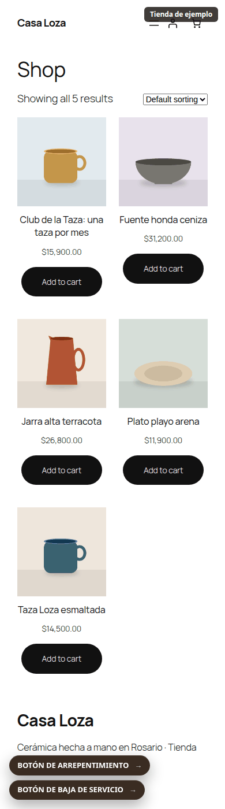
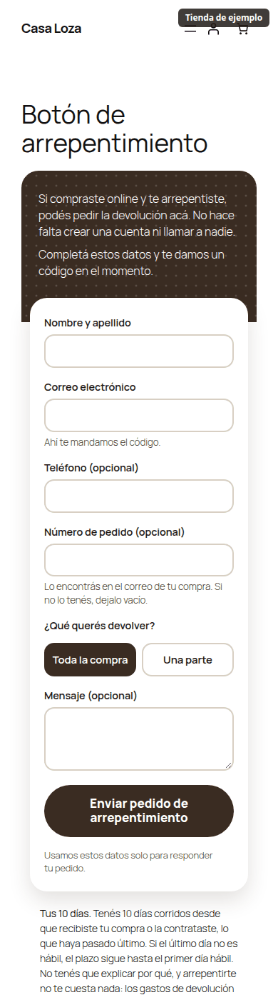
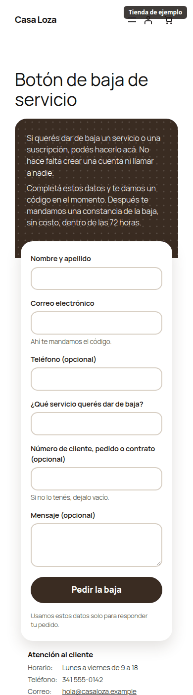
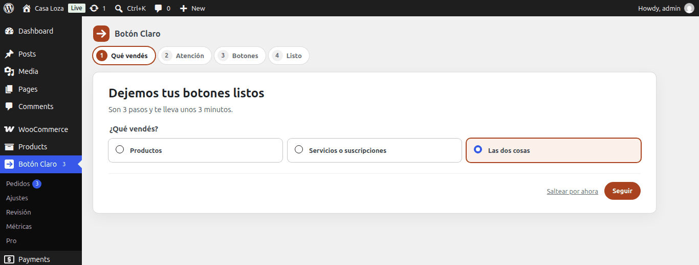
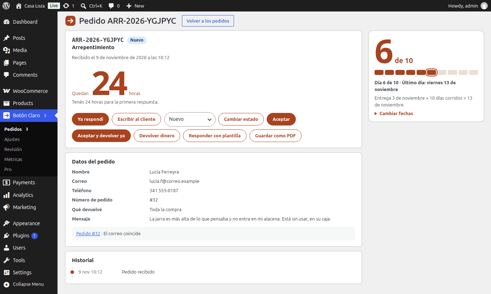

# Botón Claro – Botón de arrepentimiento y baja de servicio para WordPress y WooCommerce

**Qué es:** un plugin gratis que suma a tu sitio el "BOTÓN DE ARREPENTIMIENTO" y el "BOTÓN DE BAJA DE SERVICIO" que pide la Disposición 954/2025, con sus formularios y una lista de pedidos. 
**Para quién:** tiendas argentinas en WooCommerce y quienes venden servicios o suscripciones con WordPress, y las agencias que les arman el sitio. 
**Cómo se usa:** 1) descargá el zip de la [última versión](https://github.com/Facilo-es/boton-de-arrepentimiento/releases/latest), 2) subilo en **Plugins → Añadir nuevo → Subir plugin** y activalo, 3) seguí la configuración guiada de 3 minutos.

No decide ni responde los pedidos por vos, y no es asesoramiento legal: la respuesta a cada cliente sigue siendo tuya. Sirve para sitios hechos con WordPress, no para Tiendanube u otras plataformas.

## Así se ve

<table>
<tr>
<td width="33%" valign="top"> <b>Tus dos botones, a la vista en cualquier tema.</b> Aparecen solos en todas las páginas, en una franja al pie y en un botón flotante.</td>
<td width="33%" valign="top"> <b>Un formulario corto, sin registro.</b> Tu cliente pide la devolución sin crear una cuenta y recibe su código en el momento.</td>
<td width="33%" valign="top"> <b>La baja de un servicio, igual de fácil.</b> Con tu horario y tus datos de atención al cliente debajo.</td>
</tr>
</table>

<b>Listo en 3 minutos.</b> La configuración guiada arma los botones, las páginas de los formularios y el aviso de derechos.

<b>Con Pro: cada pedido, resuelto en un clic.</b> Ves en qué día de los 10 está el pedido, cuántas horas te quedan para responder, y aceptás o devolvés el dinero desde acá. (Esta pantalla es de la versión paga.)

## Lo que gana tu tienda

- **Ningún pedido perdido.** Cada pedido entra con su código a una lista, con aviso por correo. Si un correo falla, se reintenta y te avisamos.
- **Menos reclamos.** El cliente tiene su código al instante y sabe que su pedido llegó, sin llamar ni escribir.
- **Clientes que compran con confianza.** Los botones se ven en todas las páginas, con tus datos de atención al cliente al lado.
- **Funciona con cualquier tema,** con o sin WooCommerce, y con plugins de caché.

La versión gratis está completa: sin límites de pedidos y sin funciones bloqueadas. Tus datos y los de tus clientes quedan en tu sitio: no se conecta a ningún servicio externo.

## Preguntas frecuentes

**¿Cómo responde a cada punto de la Disposición 954/2025?**

- **Dónde va el botón y qué dice.** Los enlaces dicen exactamente "BOTÓN DE ARREPENTIMIENTO" y "BOTÓN DE BAJA DE SERVICIO", en mayúsculas y como texto real. Se ven en todas las páginas públicas desde el primer acceso, en una franja al pie y en un botón flotante, con un color y un tamaño distintos de los enlaces comunes. Un clic lleva directo al formulario, sin registro ni pasos extra. Si cambiás el texto de un botón, el plugin te avisa que ya no es el nombre exacto.
- **Los 10 días.** El aviso de derechos explica los 10 días corridos desde que tu cliente recibe o contrata la compra, lo que pase último, y que si el último día no es hábil el plazo sigue hasta el primer día hábil. Se muestra bajo el formulario y, con WooCommerce, en el checkout y en los correos del pedido. El formulario nunca se cierra: aunque hayan pasado los 10 días, el pedido llega y decidís vos. Con Pro ves el día exacto de cada pedido, con feriados nacionales incluidos.
- **El código.** Cada pedido recibe un código como `ARR-2026-4F7K9Q` (o `BAJ-…` para una baja), que tu cliente ve en pantalla en el momento y recibe por correo. En tu lista cada pedido muestra cuánto te queda de las 24 horas para responder y, en una baja, de las 72 horas para mandar la constancia.

**¿Se puede pagar en pesos? ¿Cómo se manejan los impuestos?**
Botón Claro gratis no cobra nada y no toca tus precios ni tus cobros: tu tienda sigue vendiendo en pesos como siempre. Botón Claro Pro se paga en dólares con tarjeta, a través de Freemius, que es quien vende la licencia y se ocupa de los impuestos de la venta. Tu banco puede sumar sus propios impuestos al cobro en dólares.

**¿Por qué lo hace un estudio de España?**
Facilo es un estudio chico de Andalucía, en España. El plugin sigue la norma argentina: lo armamos a partir de la Disposición 954/2025 y la Ley de Defensa del Consumidor, y todos los textos están en castellano rioplatense, con voseo. Botón Claro es una herramienta, no asesoramiento legal: ante cualquier duda, consultá con tu asesor.

**¿Hay una demo?**
Todavía no hay una demo en línea. La versión gratis es completa y se instala en un minuto, así que podés probarla en un sitio de prueba o de staging antes de usarla en tu tienda.

## Botón Claro Pro: cada pedido resuelto en un clic

Mirá al instante si un pedido está dentro de los 10 días, feriados incluidos. Aceptá, devolvé el dinero y reponé el stock en un clic, respondé con correos listos para cada caso, cancelá suscripciones con su constancia, recibí alertas antes de que venza un plazo y exportá todo a CSV.

**[Comprar Botón Claro Pro](https://checkout.freemius.com/plugin/44794/plan/78947/)**: USD 19 al año para una tienda, o USD 59 al año para tiendas ilimitadas (agencias). Tenés 14 días para recuperar tu dinero. Si dejás de pagar, todo sigue funcionando; solo terminan las actualizaciones y el soporte.

## Requisitos y actualizaciones

Requiere WordPress 6.6 o superior y PHP 7.4 o superior. WooCommerce es opcional.

Por ahora, cada actualización sale como una nueva versión en [Releases](https://github.com/Facilo-es/boton-de-arrepentimiento/releases) (para enterarte, tocá **Watch → Custom → Releases** en esta página). Cuando el plugin esté publicado en wordpress.org, las actualizaciones te van a llegar desde tu WordPress, como las de cualquier plugin.

## Quién lo hace

Lo hace [Facilo](https://facilo.es), un estudio chico de Andalucía. Consultas: [support@facilo.es](mailto:support@facilo.es). Para reportar un problema de seguridad, mirá [SECURITY.md](SECURITY.md). Licencia GPLv2 o posterior.
